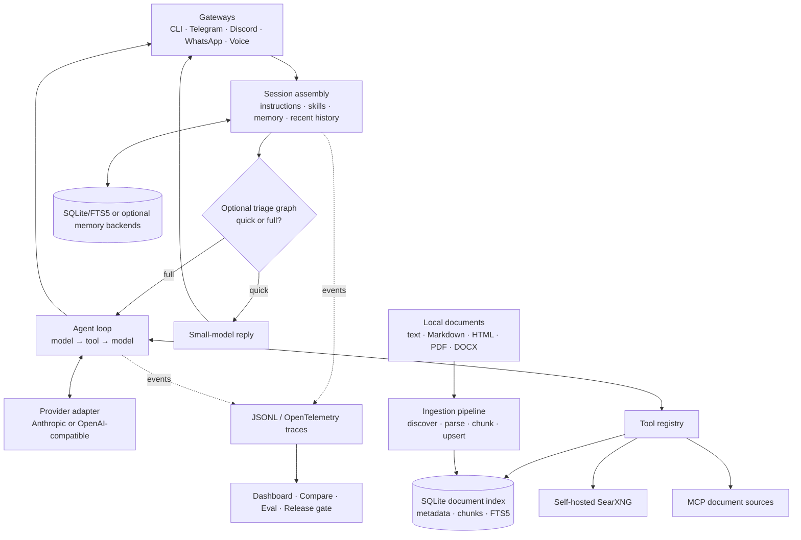

# Architecture

Tini keeps document retrieval, model orchestration, memory, and evaluation as
separate modules with narrow interfaces.

## Module Boundaries

- `tini/gateway/` transports text and calls the same runtime entry point.
- `tini/runtime/session.py` is the only context-assembly path.
- `tini/loop/` owns open-ended query refinement and provider wire formats.
- `tini/tools/` exposes `search_web` and optional namespaced MCP tools.
- `tini/documents/` owns parsing, deterministic chunking, provenance, and the
  `DocumentIndex` seam used by both ingestion and `search_documents`.
- `tini/memory/` owns retrieval gating, stores, skills, and consolidation.
- `tini/graph/` owns inspectable routing around the loop.
- `tini/ops/` and `evals/` observe and score behavior without becoming runtime
  dependencies of the loop.

## Design Decisions

The tool surface is intentionally retrieval-only. SearXNG gives operators
control over federated search, while MCP is the extension seam for filesystems,
vector databases, and internal APIs. Missing configuration and empty retrieval
results are returned honestly; there is no public search fallback.

The loop remains the RAG core because the model may need an unknown number of
searches. The graph handles only stable control flow. Its shipped triage workflow
routes social messages to a small model and knowledge questions to the unchanged
loop, failing open to the full path on errors.

SQLite, FTS5, and JSONL provide zero-service defaults. The document index
interface keeps backend-specific query syntax hidden, so a PostgreSQL/pgvector
adapter can replace SQLite without changing the pipeline or model tool.
Optional backends and telemetry integrations sit behind extras or environment
configuration. Deterministic tests pin routing and tool behavior; judge
evaluations score grounded answer quality.

For state details, see [../ARCHITECHURE.md](../ARCHITECHURE.md). For prompt and
retrieval context, see [../CONTEXT-ARCHITECHURE.md](../CONTEXT-ARCHITECHURE.md).
