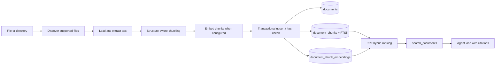

# Document Ingestion

The ingestion module turns operator-selected local files into cited chunks that
the agent can retrieve. Parsing and chunking are local; embedding calls the
configured provider when vector retrieval is enabled.



## Run it

```bash
python -m tini ingest ./internal-docs
python -m tini documents --search "deployment rollback"
```

## Use the dashboard

Run `uv run tini dashboard`, then open **Knowledge**. The page provides file and
folder pickers, drag-and-drop upload, a live stage lane, the indexed document
library, chunk inspection, and a retrieval probe. Uploads are written beneath
`.tini/documents/<workspace>/` before ingestion so reindexing has a stable source.
The light/dark switch in the header persists the selected theme in the browser.

Removing a library item removes its chunks and FTS rows, but deliberately keeps
the managed source file. Reindex reads that source again and atomically replaces
the document's chunks.

Directory ingestion is recursive by default. Use `--no-recursive` to index only
its direct children, or `--workspace engineering` to isolate a collection.
Supported formats are text, Markdown, HTML, CSV, JSON, YAML, PDF, and DOCX. The
PDF and DOCX parsers are included in the default installation.

## Guarantees

- Files larger than `TINI_DOCUMENT_MAX_FILE_BYTES` are rejected before parsing.
- Extracted text is capped by `TINI_DOCUMENT_MAX_TEXT_CHARS` before chunking.
- Directory traversal ignores symlinks and temporary Office files.
- HTML scripts and styles are excluded; parsers never execute document content.
- A content hash skips unchanged files. Changed files replace all old chunks in
  one SQLite transaction, including FTS5 rows and vectors.
- Retrieval applies `workspace_id` inside the database query and returns a
  title, source URI, and chunk ordinal for citation.
- A PDF encrypted with only an empty user password (common for official/
  government filings, e.g. Japan's EDINET securities reports — restricting
  printing/copying in a viewer, not reading) is decrypted automatically. One
  with a real password still fails with a clear `DocumentLoadError`.
- Chunk-size estimation counts CJK characters (Chinese/Japanese/Korean) each
  as their own token rather than collapsing an entire unbroken paragraph into
  one `\w+` match — otherwise `max_tokens` stopped meaning anything for
  scripts with no spaces between words.

`EmbeddingProvider` isolates Gemini and OpenAI-compatible APIs from ingestion.
`DocumentIndex` is the storage seam. `SqliteDocumentIndex` stores float32 vectors
locally and scans them for cosine similarity; `QdrantDocumentIndex` is the
self-hosted vector upgrade path described below, and a future pgvector adapter
could keep the same interface while moving ANN search and RLS into Postgres.

## Self-hosted vector index (Qdrant)

```bash
docker compose up -d qdrant                 # http://localhost:6333/dashboard
pip install 'tini-agent[qdrant]'
```

```dotenv
TINI_DOCUMENT_INDEX=qdrant
TINI_QDRANT_URL=http://localhost:6333
# TINI_QDRANT_API_KEY=                      # only if you put Qdrant behind auth
# TINI_QDRANT_COLLECTION=tini_documents
TINI_EMBEDDING_PROVIDER=gemini              # required — see the trade-off below
TINI_EMBEDDING_MODEL=gemini-embedding-2
TINI_EMBEDDING_DIMENSIONS=768
```

`python -m tini ingest`, `tini documents`, the dashboard's Knowledge page, and
`search_documents` all pick up the backend from `TINI_DOCUMENT_INDEX` through
one shared factory (`tini.documents.store.make_document_index`) — nothing else
changes. `QdrantDocumentIndex` (`tini/documents/qdrant_store.py`) is semantic
search only: Qdrant has no BM25-equivalent ranked full-text search, so it skips
the RRF fusion `SqliteDocumentIndex` does with FTS5 and requires an embedder. A
chunk that would ingest without an embedding is refused rather than silently
dropped. The dashboard's per-chunk inspector (char offsets, embedded flag)
still reads SQLite's tables directly and returns an explicit "not available on
this backend" message under Qdrant — everything else (search, list, ingest,
delete, reindex) works the same on both backends.

## Where the original files live (MinIO)

The index holds chunks only; the uploaded ORIGINAL used to be a file under
`TINI_HOME/documents/<workspace>/`, recorded as a `file://` source_uri — gone
with the container's volume and invisible to other machines. With
`TINI_DOCUMENT_STORAGE=minio` (`tini/documents/blobstore.py`) the dashboard
upload stores the original in an S3-compatible bucket instead, and the
document's `source_uri` becomes `s3://<bucket>/<workspace>/<name>`. That URI
scheme is the "where is the original" flag: the dashboard shows **MinIO** vs
**local file** per document, and Re-index fetches from the bucket and updates
the same document (no `file://` twin).

```bash
# .env: TINI_DOCUMENT_STORAGE=minio, TINI_MINIO_ACCESS_KEY, TINI_MINIO_SECRET_KEY
docker compose --profile minio up -d      # console: http://localhost:9001
```

No default credentials: choose them in `.env` (the compose profile passes the
same two values to MinIO as its root user). The bucket is created on first
upload; `pip install 'tini-agent[minio]'` for bare metal (the image has it).

- Reads are limited to the configured bucket — a `source_uri` naming another
  bucket or an unsafe key is refused, since that field comes back out of the
  index.
- **Remove** deletes the index entry only; the original stays in the bucket.
- Only dashboard uploads use this. `tini ingest <path>` still indexes local
  files with `file://` URIs.
- Documents already ingested keep their `file://` URI; re-upload to move one.

## Multilingual corpora: pick a multilingual embedding model

`nomic-embed-text` (the example above) is English-centric. Measured on the
DENSO corpus (English PDFs plus a 170-page Japanese securities report) with
the 31-question multilingual set in `evals/documents/denso_qa_multilingual.jsonl`
(Japanese, Vietnamese and English questions, several asked in a different
language than the document), same chunks, same Qdrant, only the embedding
model changed:

| | nomic-embed-text (768d) | bge-m3 (1024d) |
|---|---|---|
| Multilingual recall@3 | 17/31 (55%) | 30/31 (97%) |
| Japanese question | 12/15 | 15/15 |
| Vietnamese question | 5/12 | 11/12 |
| English question, Japanese document | 0/4 | 4/4 |
| Expected keywords found (Japanese) | 6/25 | 21/25 |
| English set recall@3 | 36/38 | 36/38 |
| Median query latency | 86 ms | 75 ms |

```bash
docker compose exec ollama ollama pull bge-m3
```

```dotenv
TINI_EMBEDDING_MODEL=bge-m3
TINI_EMBEDDING_DIMENSIONS=1024
TINI_QDRANT_COLLECTION=tini_documents_bge3   # vectors are a different size: use a new collection
```

Ingest cost was not compared like for like: bge-m3 took 11 min for the whole
corpus on CPU (including one OCR'd PDF); nomic took 5.5 min for the 395-chunk
Japanese report alone. A different model or dimension needs a fresh collection and a full re-ingest
(the same source hash is otherwise skipped). Keeping the old collection lets
you compare both models on the same questions from the dashboard's Retrieval
eval. Numbers are one run on CPU; embeddings are not perfectly deterministic,
so expect a question or two of run-to-run variation.

**GPU**: embedding is CPU-compute-bound, not request-bound — client-side
batching/concurrency has little effect, but an NVIDIA GPU does. Uncomment the
`deploy.resources.reservations` block under the `ollama` service in
`docker-compose.yml` (needs the [NVIDIA Container
Toolkit](https://docs.nvidia.com/datacenter/cloud-native/container-toolkit/latest/install-guide.html)
on the host; verify with `docker run --rm --gpus all nvidia/cuda:12.4.0-base-ubuntu22.04 nvidia-smi`
before assuming it's wired up). Measured on an RTX 3050 laptop GPU (6 GB VRAM,
comfortably fits bge-m3's ~1.2 GB): steady-state bge-m3 throughput went from
~1.3 s/chunk on CPU to ~55-60 ms/chunk on GPU, about 22x on raw embedding
calls; a full re-ingest of this corpus dropped from 11 min to well under a
minute end to end (chunking/indexing overhead included, so the wall-clock
speedup is somewhat less than the raw per-chunk number).

## Hybrid search: keyword + vector (Qdrant, off by default)

Dense embeddings match meaning; a keyword ranking matches the exact names,
figures and clause numbers they can miss. The Qdrant backend can fuse both:
each chunk also carries a sparse BM25-style vector (`tini/documents/lexical.py`),
and the two rankings are merged server-side (reciprocal-rank fusion). It is
**off by default** because on this corpus it did not beat dense-only — see the
numbers below.

```dotenv
TINI_DOCUMENT_HYBRID=1              # default 0
TINI_QDRANT_COLLECTION=<a collection that has keyword vectors, see below>
# TINI_DOCUMENT_FUSION=rrf|dbsf     # default rrf
# TINI_DOCUMENT_LEXICAL_WEIGHT=1.0  # rrf only: the keyword side's vote
```

**The tokenizer is the reason this is not just SQLite FTS5.** FTS5's default
tokenizer splits on whitespace and Japanese has none, so a whole sentence is one
token and `指名委員会` matched nothing (tried; `trigram` fixes it but is blind to
terms under 3 characters such as `議長`). Here a run of CJK characters becomes
overlapping character bigrams (`取締役会` -> 取締 締役 役会) and everything else
is split into words, with no dictionary and no dependency. The SQLite backend's
FTS5 leg still has the whitespace problem.

**Existing collections must be migrated.** Qdrant cannot add a vector to a
collection that already exists (checked against v1.19.1: `update_collection`
answers "Not existing vector name"), so a collection built earlier stays
dense-only and works exactly as before. To get keyword vectors:

```bash
python scripts/qdrant_add_hybrid.py tini_documents_bge3 tini_documents_bge3_hybrid
```

This copies each point's dense vector and payload into a new collection and
builds the keyword vector from the text already stored there: no embedding, no
API call, no original file needed (8 of the 9 DENSO files can no longer be read
by the container). The source collection is left untouched as a backup. New
collections are created with keyword vectors from the start.

**Measured 2026-09-25** on the same 8 documents / 830 chunks, k=3, rerank off
(snapshots `dense-only-2026-09-25.json`, `hybrid-bm25-2026-09-25.json`;
dense-only on the migrated copy reproduced the earlier 36/38 and 40/47 exactly):

| | dense only | hybrid (rrf, weight 1.0) | hybrid (rrf, 0.5) | hybrid (rrf, 0.1) | hybrid (dbsf) |
|---|---|---|---|---|---|
| denso_qa (38) | 36 | 36 | 36 | 36 | 37 |
| multilingual (47) | 40 | 36 | 38 | 40 | 34 |
| median latency | ~88 ms | ~92 ms | | | |

No setting beat dense-only overall. Lowering the keyword weight just walks the
result back to dense-only (0.1 is identical to it), and score-based fusion
gained one English question while losing six multilingual ones. The regressed
questions are the cross-language ones: an English or Vietnamese question whose
answer is in a Japanese document (`en-x-founded`, `vi-x-founded`,
`en-x-employees`). The keyword side has no shared word to catch there and votes
for English chunks that merely share "when", "was", "the". Splitting all 85
questions by whether question and answer share a language: same-language,
dense 55/60 vs hybrid 54/60; cross-language, dense 21/25 vs hybrid 18/25. So the
expectation that keywords would help the same-language questions was **not**
borne out either: dense already gets 92% of those, and the few it misses are
not the ones a keyword match rescues (hybrid fixed 2 and broke 3). The language
split uses a rough rule (does the expected keyword contain Japanese?), and a
1-2 question swing between two runs of the same configuration was seen, so read
these as "no evidence of a gain", not as a measured loss of a few points.

This corpus is small (8 documents) and its questions are mostly ones dense
already answers; hybrid may earn its place on a larger corpus with many
similar documents, exact identifiers, or same-language queries. Re-run
`scripts/document_baseline.py` with `TINI_DOCUMENT_HYBRID=0` and `=1` on the
larger set before turning it on.

## Cross-language search: translate the question (off by default)

Hybrid search's regressions above are all the same shape: a question in one
language whose answer sits in a document written in another. A dense
multilingual embedding is supposed to close that gap on its own; the obvious
fix if it doesn't is to remove the gap before searching — ask the small model
to translate the question into each language the corpus is written in, search
with the original and every translation, and fuse the rankings
(`tini/documents/multilingual.py`, reciprocal-rank fusion, same idea as the
hybrid fusion above). A failed or slow translation falls back to the original
question alone and is counted, never silently dropped — a call that hung for
6 minutes against one endpoint is why there's both a timeout and a breaker
that pauses translation for a while after repeated failures.

```dotenv
TINI_QUERY_LANGUAGES=ja,en   # empty (default) = off; costs one small-model call per new question
```

**Measured 2026-09-25** with DeepSeek as the translator, `ja,en`, rerank off,
on the same corpus as the hybrid numbers above (snapshot
`translate-ja-en-2026-09-25.json`):

| | dense-only | + translate ja,en |
|---|---|---|
| denso_qa (38) | 36 | 34 |
| multilingual (47) | 40 | 39 |
| median latency, multilingual | ~88 ms | ~3.5 s |
| p95 latency, multilingual | ~110 ms | ~16.4 s |

Translation fixed one question (`ja-x-hr-scope`) and broke four
(`board-officer-separation`, `governance-2025-diversity`, `ja-zero-emission`,
`ir-stock-code`) — a net loss, not the fix the cross-language regressions
above were hoping for, at roughly 40-180x the latency (one extra model call
per question, sequential with the search itself) and 3 translation failures
out of 38 on the English set alone. **No evidence this corpus needs it**; off
by default. It was tried once, on the same 8-document corpus every other
number on this page comes from — a corpus this small mostly asks questions
dense embeddings already answer, so this is a weak test of the idea, not a
refutation of it. `examples/denso_synthetic/` (generated with
`scripts/synth_corpus.py` for exactly this gap — the real corpus has no
Vietnamese document, and `denso.com` blocks automated downloads) has documents
in only one language each and asks every fact in all three; it's a fairer
place to retry translation before drawing a real conclusion, and hasn't been
run against it yet.

**The answer's language is a separate problem from retrieval.** A Vietnamese
question is often answered from a Japanese or English passage, and a model tends
to follow the language of its evidence. Each turn's context
(`reply_language_note` in `tini/runtime/session.py`) therefore says to reply in
the language of the user's message, keeping product names, codes and figures as
written and adding a short translation where a source term matters. Japanese and
Vietnamese are named when detected; anything else gets the generic line only,
because `detect_language` reads all other text as English and naming a guess
could make the model answer in the wrong language. The line sits in the volatile
context, not the system prompt, so the cached prefix is unchanged. **Not
measured**: no question set here scores the language of the answer.

## Reranking (default: the self-hosted bge-reranker; Jev is the hosted option)

**Default is `TINI_RERANK_PROVIDER=tei`** (see [the local reranker](#self-hosted-reranking-bge-reranker-v2-m3-tini_rerank_providertei)):
because the reranker is a docker service, a machine that has not started it
falls back to vector order on every search rather than failing, and the failure
is counted (a Retrieval eval run says how many searches were not reranked). Set
`TINI_RERANK_PROVIDER=none` to skip reranking, or `jev` for the hosted one
described next. The Jev measurements below predate the local provider and still
stand for Jev.

Vector search returns the chunks nearest the question. In the
[baseline](eval-baseline.md) the right document is found ~95% of the time but
for table-heavy sources only 62% of the expected facts appear in the returned
chunks: the answer chunk is near, not nearest. Reranking fetches a wider pool
(`TINI_RERANK_CANDIDATES`, default 20), lets a second model score each
candidate against the question, and keeps the best `top_k`. It wraps any
index (`RerankingIndex`), so the agent's `search_documents` tool, the CLI and
the dashboard all get it.

```dotenv
TINI_RERANK_PROVIDER=jev
TYPESAFE_API_KEY=...
```

**Status: measured against the live API, once (2026-09-24), on the 47-question
multilingual set at k=3.** Recall went from 40/47 (85%) to 43/47 (92%) — a
real gain, but concentrated and uneven, and it comes at a steep latency cost:

| | off | on (Jev) |
|---|---|---|
| recall@3 | 40/47 (85%) | 43/47 (92%) |
| ja | 25/28 (89%) | 27/28 (96%) |
| vi | 10/13 (77%) | 10/13 (77%) — **no change** |
| en | 5/6 (83%) | 6/6 (100%) |
| table-heavy-pdf | 23/27 (85%) | 24/27 (89%) |
| text-pdf | 15/18 (83%) | 17/18 (94%) |
| scanned-pdf | 2/2 (100%) | 2/2 (100%) — n too small to move |
| median latency | 20.5 ms | 1378.4 ms |
| p95 latency | 98.7 ms | 1652.2 ms |

Vietnamese got zero benefit — the exact risk the "language support
undocumented" caveat below was flagging, now confirmed rather than
hypothetical. Median latency went from 20.5 ms to 1378.4 ms, ~67x — one
search now costs over a second, well above TypeSafe's own 70-500 ms claim
(see the Latency bullet below); if a brief asks for "retrieval latency" as
the headline number, this is not a free accuracy win. One run, one corpus —
re-run `python scripts/document_baseline.py with-jev --rerank on --compare
evals/baselines/bge-m3-dense-2026-09-24.json` before trusting this further
or deciding whether the tradeoff is worth it for a given use case.

**With an LLM on top (DeepSeek, same run + reranking on):** recall/by-lang/
by-format matched the retrieval-only Jev run above (43/47, ja 27/28, vi
10/13, en 6/6) — reassuring, not a fluke of that one run — with median
retrieval latency 1520.5 ms (p95 1958.2 ms, in the same range as before).
The new number is **answer keyword rate: 77%** — of the expected keywords,
how many actually appear in DeepSeek's generated answer text (not just the
retrieved chunks) — plus a median **~5496 ms** per LLM call on top of
retrieval. End to end, one question costs roughly 1.5 s retrieval+rerank +
5.5 s generation ≈ 7 s. No LLM-mode run without reranking exists yet to
isolate how much of that 77% the reranking step itself is responsible for
versus DeepSeek's own answer quality.

**Re-measured 2026-09-25** on the current corpus (8 documents, 830 chunks,
k=3, 20 candidates, 0 rerank errors; snapshots
`evals/baselines/rerank-off-2026-09-25.json` and `rerank-jev-2026-09-25.json`):

| | off | on (Jev) |
|---|---|---|
| denso_qa (38 questions) | 36/38 (94.7%) | 34/38 (89.5%) — **worse** |
| multilingual (47 questions) | 40/47 (85.1%) | 43/47 (91.5%) |
| median / p95 latency, multilingual | 31.2 / 46.5 ms | 1252 / 1653 ms |

The multilingual result reproduces 2026-09-24 exactly (40 -> 43; ja 27/28,
vi 10/13, en 6/6). The new number is on the English set: Jev **lost** two
questions (`board-officer-separation`, `gov2025-nomination`) and fixed none.
Across both sets that is 4 questions fixed and 3 broken (76/85 -> 77/85), so
the gain is small and not uniform. Each question set is one
run against a hosted model, so a 1-2 question swing is inside what I would not
call signal without repeating it.

- **Jev is not a purpose-built reranker.** It is TypeSafe's hosted "System
  One" decision model (typed answers with calibrated probabilities). Here it
  is asked one yes/no question per candidate ("does this document contain what
  the query asks for?") and the returned probability is the score. Its docs
  do not state language support, so Japanese and Vietnamese quality is an
  open question the eval has to answer.
- **Privacy.** Every search sends the question and the candidate chunks' text
  to `api.typesafe.ai`. The endpoint is fixed in the code on purpose — a
  setting that could redirect document text elsewhere is a way to leak it.
  Provider `none` keeps everything local.
- **Failure is visible, not silent.** If the provider errors, the search falls
  back to vector order and the failure is counted; the eval reports
  "N of M searches fell back", so an outage cannot pass as "reranking made no
  difference".
- **Latency.** One extra network call per search. TypeSafe reports 70-500 ms;
  measured from this network median latency was 1378 ms (p95 1652 ms) —
  well above that claim, whether from geography (the service is hosted in
  US West), the 20-candidate batch per call, or something else unmeasured.
- **Self-hosted alternative: built, measured below** (`tei`). Ollama has no
  rerank endpoint, so it is served by Hugging Face text-embeddings-inference.

### Self-hosted reranking: bge-reranker-v2-m3 (`TINI_RERANK_PROVIDER=tei`)

`BAAI/bge-reranker-v2-m3` (Apache-2.0, multilingual, built on the same backbone
as the bge-m3 embedder) is a cross-encoder: it reads the question and one
candidate together, which a vector search cannot do, so it can tell a chunk that
is *near* the question from one that *answers* it. It runs in the compose
`reranker` profile behind text-embeddings-inference's `POST /rerank`:

```bash
docker compose --profile reranker up -d reranker   # first start downloads ~2.2 GB
```

```dotenv
TINI_RERANK_PROVIDER=tei                  # the default; none | jev to change
# TINI_RERANK_URL=http://127.0.0.1:8081   # the default
```

The default compose image is the CPU one (works anywhere, slow for a
cross-encoder); an NVIDIA card wants the GPU image through the git-ignored
`docker-compose.override.yml`, same as `ollama` (`86-1.8` for RTX 30-series —
see the comment in `docker-compose.yml`). On this machine's RTX 3050 the model
uses ~1.25 GB of VRAM, so it sits next to the embedder in 6 GB.

**The address is restricted, not fixed.** Unlike Jev, whose endpoint is a
constant, this provider has a URL setting because the server has to be found —
so the "reranker receives document text" rule is enforced by validation instead:
`local_rerank_url` accepts only `127.0.0.1`, `localhost`, `::1` or the compose
service name `reranker`, compared as a parsed host (so `localhost.evil.example`
and `http://localhost@evil.example` are refused), no credentials, no path. Any
other value stops startup with an error. The compose port is published on
loopback only.

**Measured 2026-09-28**, k=3, dense retrieval (hybrid and translation off), RTX
3050, one run per row. Snapshots: `bge-reranker-c20/c50-2026-09-28.json`,
`xl2-dense/xl2-bge-c20/c50-2026-09-28.json`. "Answer" = the expected answer text
is inside the returned chunks, which is stricter than "the right document
appears" and is where reranking shows up:

| 85 real questions | document hit | **answer in chunks** | median latency |
|---|---|---|---|
| dense only | 76 | 60 | ~90 ms |
| Jev (24/09) | 77 | 69 | ~1300 ms |
| bge-reranker, 20 candidates | 76 | 69 | ~510-620 ms |
| bge-reranker, 50 candidates | 77 | **72** | ~1100-1300 ms |

| 108 synthetic questions (`examples/denso_synthetic/`) | document hit | **answer in chunks** | median latency |
|---|---|---|---|
| dense only | 97 | 74 | ~85 ms |
| bge-reranker, 20 candidates | 97 | 90 | ~625 ms |
| bge-reranker, 50 candidates | 97 | **91** | ~1360 ms |

What it does well: it picks the right *part* of the right document. Document hit
barely moves (that was never the problem), but the answer lands in the returned
chunks 16-17 more times out of 108 on the synthetic set (same-language 25 -> 33
of 36, cross-language 49 -> 57-58 of 72), and on the English real set 30 -> 35
(20 candidates) and 37 of 38 (50). It also does it ~2x faster than Jev at 20
candidates and for free. Going from 20 to 50 candidates buys 1-3 more answers
for about twice the latency, so the default stays 20.

Where it is worse, said plainly: on the multilingual real set Jev still wins
(39 vs 34-35 answers). Two Vietnamese questions (`vi-mission`, `vi-hr-scope`)
that dense got right are now wrong: given a Vietnamese question the reranker
preferred topically close *Japanese* chunks over the English chunk stating the
answer. (A third, `ja-x-mission`, is a scoring artifact: all three returned
chunks contain the answer, from other DENSO documents, but the question set
expects one specific document.) The synthetic set shows the same weak spot,
Vietnamese question -> English document stays at 8/12 answers, unchanged from
dense. It is not a fix for the Vietnamese gap.

Read with the usual limits: one run per row, small corpora (8 and 9 documents),
a 1-2 question swing between identical runs has been seen, and the synthetic
documents are translated excerpts, cleaner than real PDFs.

### Reading a Vietnamese question in English (`TINI_RERANK_TRANSLATE=vi`, off by default)

Why Vietnamese was the weak language: retrieval was not the problem, the
**reranker** was. On 49 Vietnamese questions, taking the same candidate pool and
scoring it with the question translated to English instead of as asked (only the
reranker's copy; search still uses the question as asked) moved documents found
from 43 to 47 and answers found from 40 to 43 at k=6, and 41 to 44 / 39 to 42 at
k=3. Fusing an English search into the pool (tried first) changed nothing; the gain
is in how the cross-encoder scores a Vietnamese question against an English chunk.

Measured end to end through the real factory (translation by `deepseek-v4-flash`,
hybrid + rerank 50, all 193 questions of the real and synthetic sets, k=6):

| | documents | answers found | Vietnamese answers | Japanese / English answers |
|---|---|---|---|---|
| off | 183/193 | 173/193 | 40/49 | 59/64, 74/80 |
| `vi` translated for the reranker | 187/193 | 176/193 | 43/49 | 59/64, 74/80 (identical) |

Japanese did not benefit (translating Japanese questions was neutral to slightly
worse), so only the languages you list are translated, and only `vi` was measured.
The switch costs **one small-model call per new question** (1.3-5 s here, cached
afterwards) on top of the ~1.3 s a 50-candidate rerank already takes, and it sends
the **question, never a document**, to that model. It fails open: a slow or failing
model (the translator has a 20 s timeout and a circuit breaker) leaves the question
as asked and is counted (`rerank_translate_errors` in an eval run). Use it with a
fast `TINI_SMALL_MODEL`; it is off by default because the maintainer's default small
model takes minutes and would only ever time out. 49 questions, machine-translated
Japanese and Vietnamese documents: a direction, not a promise.

## OCR fallback for scanned/image-only pages

A PDF page averaging under ~40 extracted characters is treated as scanned:
`pypdf`'s plain text extraction found essentially nothing, most likely because
the page is a raster image rather than real text. Left unconfigured, that
page ingests as-is — usually near-empty — with an `ocr_skipped` note in the
document's metadata so it's visible *why*, rather than a thin document just
quietly looking like a thin source.

```bash
pip install 'tini-agent[ocr]'
```

```dotenv
TINI_OCR_PROVIDER=deepseek
TINI_OCR_MODEL=deepseek-v4-flash-vision-exp
# TINI_OCR_API_KEY=   # falls back to DEEPSEEK_API_KEY / OPENAI_API_KEY
# TINI_OCR_BASE_URL=  # falls back to the provider's known default endpoint
```

`tini/documents/ocr.py` tried CPU-only local OCR (PaddleOCR) first, since a
self-hosted default matches this project's local-first defaults — abandoned
after three attempts, all failing the same way (an unimplemented oneDNN
CPU-backend op) or hanging indefinitely with oneDNN disabled. `TINI_OCR_*`
instead points at a vision-capable chat model over the same OpenAI-compatible
wire format the embedding providers already use; any such endpoint works, not
just DeepSeek. When a page looks scanned, `tini/documents/loaders.py` renders
it to a bitmap with `pypdfium2` (PDFium — the engine Chrome uses; no external
poppler binary) exactly as a viewer would show it, and sends that image to
the model with a transcription prompt. Pulling the page's embedded image out
directly via `pypdf` was tried first and abandoned too: on real scanned PDFs
it frequently decoded the wrong or a corrupted fragment (mismatched
image/soft-mask dimensions), silently losing most of the page's content — a
composed-page render doesn't have that failure mode. One page's OCR call
failing doesn't sink the whole document; the failure count lands in
`ocr_failed_pages` instead of vanishing.

### What OCR costs per document

Every OCR'd document appends one row to `TINI_HOME/ocr_usage.jsonl` — title,
pages, prompt and completion tokens, provider/model, and whether the run was
kept (`created`/`updated`) or discarded (`skipped`). Tokens only: dollars are
derived when read (`tini/ops/ocr_cost.py`), so correcting a rate fixes past
rows. The dashboard's Documents header shows the average per document once
any scanned file has been ingested (hover for per-page cost and the rate).

Measured 2026-09-25 with `deepseek-v4-flash-vision-exp` on the one scanned
file in the corpus (`supply-chain-doc-sustainability-guidelines-en.pdf`,
15 pages, rendered at 2x):

| | per page | per 15-page document |
|---|---|---|
| prompt tokens | 1,080 (identical every run: a page image is a fixed size) | 16,200 |
| completion tokens | ~400-430 (the transcription; varied 5,979 vs 6,431 between runs) | ~6,000-6,400 |
| cost at $0.15 / $0.30 per M tokens | ~$0.00029 | ~$0.0043 |
| cost at the provider-level $0.435 / $0.87 estimate | ~$0.00084 | ~$0.0126 |

The two rate rows are the same tokens priced two ways: the model is documented
as priced like `deepseek-v4-flash` ($0.15/$0.30) but `tini/ops/pricing.py`'s
generic `deepseek` fallback is ~2.9x higher, so treat the dollar figure as an
estimate and check your provider's current price. Average cost per document
scales with page count: **cost ≈ pages x ~$0.0003** at the lower rate. One
sample document, so the per-document average is really a per-page average
times your page count. Wall-clock for the 15 pages with 4-way concurrency was
~15 s.

**Each page is OCR'd once.** OCR runs before the index decides whether a file
is unchanged, so a plain re-ingest used to pay for the whole document again and
then report `skipped` (measured: the same ~$0.0042 and ~14 s for nothing). It
would also have re-paid whenever the text had to be re-read for a new embedding
model or chunk size. Instead the transcription of each page is cached under
`TINI_HOME/ocr_cache/`, keyed by the page image, the OCR model and the prompt
version (`PROMPT_VERSION` in `tini/documents/ocr.py` — bump it if you change the
prompt). Only successful responses are cached (a failed page is retried next
time; a blank page is a real result and is cached). Re-checked with the real
API on the same 15-page file: run 1 paid (15 pages, ~$0.005), runs 2 and 3
made no API call (30 cached pages, `wasted_cost` 0, ~5 s instead of ~14 s).
The ledger's `cached_pages` counts the pages served this way. The cache holds
document text in plain files under `TINI_HOME`, like the index does; deleting
a document does not delete its cached pages, and `rm -r ocr_cache` is safe
(the only cost is paying again).

### Table-aware OCR: two flows instead of one (`TINI_OCR_TABLE_FLOW`, off by default)

The default OCR call above does two jobs in one prompt: transcribe the page's
prose, and render any table on it as Markdown. That Markdown is just more prose
to `tini/documents/chunking.py` — no boundary tells the chunker "this is a
table" — so a table wider than `TINI_DOCUMENT_CHUNK_MAX_TOKENS` (512 by default)
gets cut wherever the paragraph/sentence splitter happens to fall, which for a
table of numbers is usually nowhere sensible. Verified by running the real
chunker on a 70-row table shaped like the corpus's own securities-report sales
tables (`chunk_text(..., max_tokens=512)`): it came back as 4 chunks, 2 of
which had **no header row at all**, one of them starting mid-cell
(`| Region` / `-33 | 2,227,963 | 105.6 |`, split between the two). A chunk
missing its header embeds numbers with no label for what they are.

```dotenv
TINI_OCR_TABLE_FLOW=1
```

When on, the transcription call's prompt changes: it skips tables entirely,
leaving a `[[TABLE:n]]` marker in their place instead of Markdown. A page
whose transcription contains at least one marker gets **one further call** —
`extract_tables()`, same page image — asking only for the tables on it, as
JSON (`{"tables": [{"caption", "columns", "rows", "notes"}]}`) rather than
Markdown. `tini/documents/loaders.py` replaces each marker with a
`<!--tini:table id=n-->...<!--/tini:table-->` block built from that JSON, and
`chunking.py` chunks that block **by row** instead of by paragraph/sentence:
rows are packed under `max_tokens` and the caption/header/separator are
repeated at the top of every resulting chunk, the same role sentence-overlap
plays for prose — a chunk landing mid-table is still self-contained. A row
wider than `max_tokens` on its own is kept whole rather than cut (an oversized
chunk, visibly marked via `estimated_tokens`, not a corrupted row). A page with
no marker never triggers the second call, so a document without tables costs
what it always did; a page whose second call fails leaves its marker as
literal `[[TABLE:n]]` text and counts it in `ocr_failed_tables` — visible, not
silently dropped, the same rule `ocr_failed_pages` already follows.

Turning it on changes the transcription prompt, so it uses its own slice of
`ocr_cache/` (keyed by flow + prompt version, not just the model) — switching
`TINI_OCR_TABLE_FLOW` never serves one flow's cached text under the other's
key, but a document OCR'd before turning this on keeps its old Markdown tables
until it's re-ingested.

**Not yet measured against the single-call flow.** The chunking failure above
is real, run against this repo's own chunker; whether splitting the OCR call
in two actually improves retrieval on a table-heavy document (or whether a
single prompt handles a real merged-header table worse, the open question in
the design write-up this shipped from) has not been checked with a live model.
Off by default until it has been. To measure it: re-ingest a table-heavy
document with the flag on, then re-run `document_baseline.py` on a
`table-heavy-pdf`-tagged question set and compare against a run with the flag
off, the same way `TINI_DOCUMENT_HYBRID` was evaluated above.

## Table retrieval: a small technique-by-technique set

DENSO's engineering documents are not public (`denso.com` returns 403 to
automated clients and this repo does not work around that), and the one public
technical manual found (the Spark Plug manual, see `examples/denso_tech_docs/`)
has charts and no tables. So `scripts/synth_tech.py` generates fictional
engineering tables, with no model, in `examples/denso_tech_synthetic/`: torque
chart, thermistor table, connector pin-out, fault-code list, sampling plan,
supplier quality table, injector and ignition-coil data sheets, in en/ja/vi, half
as Markdown tables and half as the aligned plain text a PDF extractor returns.

The question set (`evals/documents/synthetic_denso_tech.jsonl`, workspace
`denso-tech`) is **ten facts, each aimed at one way a table breaks retrieval**,
asked in three languages (30 questions); its `format` field is the technique, so
the dashboard's per-format chips are a technique breakdown: `grouped-header`,
`late-row`, `chunk-boundary`, `multi-row`, `semantic-key`, `code-key`,
`plain-lookup`. Each technique is one fact asked three ways, so read a "3/3" as
one success. It says *which* table problem a change fixes or causes; it is not a
benchmark.

**What it showed before the fix (k=6, workspace with the 9 real DENSO documents
and the manual as distractors):** dense-only found the answer for all 30; hybrid
without rerank 29; hybrid plus rerank over 50 candidates **27**. All three misses
were one fact (`grouped-header`: a lubricated-torque cell in the last chunk of the
torque table). The document was ranked first every time; the chunk holding the row
was not, because by then the row is bare numbers (`M36 | 100.3 | 78.1 | ...`) with
the header that says what each column means left in the first chunk. A
cross-encoder reads the question and one chunk together, so it cannot tell such a
chunk from any other table of numbers, which is why reranking, the step that helps
prose, hurt here. The plain chunker also cut one pin-out row in half.

### Header on every chunk (`TINI_TABLE_CHUNKING`, on by default)

A table written as Markdown pipes or as aligned plain columns is now chunked by
ROW (`chunking.py`, `_split_plain_tables`): the nearest heading, the caption lines
under it, the header lines (a two-level header included) and the footnote go on
**every** chunk, and a row is never cut. It reuses the row packer the OCR table
flow already had.

What counts as a table is deliberately strict, so prose, lists and code never
qualify: at least four data rows; at least 70 % of them holding a numeric cell;
for aligned text, the same number of columns (two or more spaces apart) on 80 % of
rows and a first line that reads as a header; a two-cell group header sitting right
above the columns belongs to the table. A table whose header row is numeric (years)
is still recognised when it is a Markdown table.

**Measured on the same 30 questions after re-ingesting:** hybrid plus rerank went
from 27/30 to **30/30** at k=3 and k=6 (`grouped-header` 6/9 → 9/9); dense-only
stayed 30/30, and hybrid without rerank went 29/30 → 30/30 at k=6. The chunk
counts of the nine real DENSO documents and the Spark Plug manual did not change
at all (338, 18, 27, 395, 2, 39, 2, 3, 9 and 104), because text extracted from a
PDF puts single spaces between columns and never qualifies, so the retrieval
numbers on the real question sets are unaffected. That is also the limit: **a
table inside a PDF is not helped** (its rows arrive single-space separated); only
Markdown/text tables and OCR'd tables are. Thirty questions is one fact per
technique, so this shows the mechanism works, not how much it is worth; a document
already in the index keeps its old chunks until it is re-indexed.

## Generation eval: what the agent does with what it retrieves

Retrieval evals stop at "were the right chunks returned". `scripts/generation_eval.py`
(logic in `tini/ops/generation_eval.py`) runs the same turn `Tini.respond` runs (the
real system prompt, the real `search_documents` tool, the real loop) minus memory,
the retrieval gate and the chat log, so it never touches `.tini/`, and scores:

| measure | how |
|---|---|
| answered | every expected keyword is in the reply (deterministic) |
| retrieval-limited vs generation-missed | the keywords were / were not in the chunks the agent actually saw, so a miss is attributed to retrieval or to the model |
| cited | the reply names the expected document (deterministic) |
| page | for an answer that came from a PDF chunk: the reply names a page (`p.7`, `pp.7-8`, `page 7`, `trang 7`, `7ページ`) that the chunk holding the answer covers. Shown as *right page / answered PDF questions*; a range counts every page in it, and a source without pages is not checked (deterministic) |
| language | `detect_language(reply)` equals that of the question (deterministic) |
| faithful | a **judge model** reads the question, the evidence the agent saw and the reply: is every claim supported? (an opinion, kept per row for audit) |
| declined / invented | on 12 questions whose answer is not in the documents (a torque row past the end of the table, an injector and a supplier that do not exist, a year the reports never reach), did it say so, or give a value? (judge) |

54 questions: 12 + 6 real, 12 synthetic prose, 12 synthetic tables, 12 unanswerable
(`evals/generation/unanswerable.jsonl`), spread over en/ja/vi. `--no-language-note`
drops the reply-language line so the A/B for that line is one flag. Counts, not
percentages, because 54 is small.

**Status: built and unit-tested, no trustworthy numbers yet.** The one run that
got started used DeepSeek, whose balance ran out mid-run (HTTP 402 on most
questions), and the repo's default judge (`gpt-5.6-sol`) has an invalid key here.
Running on the configured model (`SDS-AI/softdream`, ~22 s for a one-word reply)
timed out on 13 of 24 questions, leaving 11, too few to read. What the few
completed DeepSeek rows did show, as observations and not measurements: replies are
long (median ~1,800 characters, often with tables), the agent searches about 2.4
times per question, and the first judge pass was too strict because it saw only
14,000 characters of evidence (now 60,000), so its faithfulness counts were
discarded. To get real numbers, run it with a generator and a judge that are both
reachable and different from each other:

```bash
python scripts/generation_eval.py run --label flash --provider deepseek --model deepseek-v4-flash     --judge-provider deepseek --judge-model deepseek-v4-pro          # ~2.7M input tokens for two arms
python scripts/generation_eval.py run --label flash-nonote ... --no-language-note
python scripts/generation_eval.py compare evals/baselines/generation-flash-*.json evals/baselines/generation-flash-nonote-*.json
```

## What re-ingesting costs after a manual edit

Ingestion embeds a document's chunks *before* the index decides whether the
file changed, so re-ingesting used to re-embed everything: measured on the
338-chunk Japanese Integrated Report (local GPU), an **unchanged** re-ingest
embedded all 338 chunks (23 s) and then reported `skipped`, and a
**one-paragraph edit** embedded all 338 again (23 s). With a hosted embedding
API that is money, not just time. Vectors are now cached in
`TINI_HOME/embed_cache.sqlite` by a hash of (provider, model, dimensions,
title, chunk text) — `TINI_EMBEDDING_CACHE=0` turns it off:

| re-ingest of the same report | chunks embedded | time |
|---|---|---|
| first ingest | 338 | ~40 s |
| unchanged file | 0 | 0.2 s |
| one paragraph edited by hand | 1 | 1.0 s |

Chunks are cut on paragraph/heading boundaries, so an edit only changes the
chunk(s) around it. OCR has its own per-page cache (see the OCR section), so a
scanned file costs API money only for pages whose image changed. A different
embedding model, a renamed document (the title is part of the key) or a new
chunk size still re-embeds — those really are different vectors. Queries are
never cached. The cache stores vectors, not chunk text; deleting a document
does not delete its cached vectors, and removing the file is always safe.

## Managing documents: the catalog

The dashboard's Knowledge page keeps a **catalog** next to the index: for each
document a type (report, governance, internal policy, supplier requirements,
other), a kind, a period/version (e.g. `FY2024`), an issuer, a status (current,
superseded, needs checking, excluded), an optional summary, and a profile of how
it is built (pages, language, scanned or text, table density). It lives in
`TINI_HOME/state.db` (`tini/documents/catalog.py`), keyed by (workspace,
source URI), so it works the same under SQLite and Qdrant. The library can be
filtered by type or by "needs review", and **Edit** opens the entry.

**Classification** is rule-based (title, filename, the first ~3,000 characters),
reports a confidence and the text that triggered it, and flags anything under
80% for review instead of trusting it. A document names itself at the top
("統合報告書2025", "Corporate Governance Report") and only *mentions* other
types later, so the earliest match wins, not the most confident one (picking by
confidence labelled the Integrated Report a securities filing). On the 9 DENSO
files it matches my hand labels 9/9, but the rules were tuned on those same
files, so this is a sanity check, not an independent accuracy figure. The
"table-heavy" threshold (0.10) rests on one example. No model is called.

**Refresh catalog** classifies every indexed document from the text the index
already holds (`opening_text`): no original is re-read, nothing is OCR'd or
embedded, so it costs nothing (9 documents: 2 s) and works for documents whose
original this machine cannot open. That matters here: 8 of the 9 DENSO
documents were ingested from a Windows host path (`file:///D:/...`) that the
container cannot read, so **Re-index fails for them** while cataloguing works.

**What editing and re-ingesting cost:**

| action | API/model cost | time |
|---|---|---|
| edit type / period / status / summary | none — metadata only, no re-ingest | instant |
| refresh catalog (9 documents) | none | ~2 s |
| re-index an unchanged file | none: OCR pages and chunk vectors come from their caches | dominated by PDF parsing, ~17.5 s for a 56-page Japanese PDF (pypdf, CPU) |
| one paragraph of a document edited | 1 of 338 chunks embedded | ~1 s for text files; PDFs add the parse time |
| scanned file, unchanged | 0 OCR pages (cached) | render only |

An edited field is **locked**: a later re-ingest of a changed file refreshes the
profile and the automatic fields but never overwrites a locked one, and if an
automatic field would have changed it flags the entry for review. Unchanged
content (same hash) is not re-classified at all. Removing a document removes its
catalog entry. Re-parsing the same unchanged PDF is the one remaining repeated
cost, and it is time, not money.

**Status is enforced at search time.** A document marked *superseded* or
*excluded* stays in the index but `search` never returns it
(`tini/documents/visibility.py`, the innermost wrapper, so translation and
reranking only see visible chunks). *Needs checking* stays searchable. Before
this, the status was only a label: an old edition answered like the current one,
and a README marked "excluded" was still retrievable. Flipping the status back
brings the document back at once, with nothing re-embedded. The filter reads the
catalog on every search rather than copying status into the Qdrant payload, so
an edit cannot leave the two out of step; with nothing hidden it costs one small
SQLite query. When something is hidden it looks at up to 3× the requested
results (then once at 50) so hidden chunks do not shorten the page.

In a Retrieval eval, a question whose expected document is hidden is **expired**:
it is left out of recall and answer-in-chunks (it could only miss, which read as
a broken retriever — the DENSO 2021 governance policy, marked superseded by the
2025 report, was dragging the real set down by 5 questions) and is checked the
other way round instead: the hidden document must not come back (`expired.leaked`
in the result, 0 is correct). The question files are not edited, so the same set
scores those questions normally wherever the document is still current.

Not built, on purpose: a `language` filter. With an oracle that knew each
document's language, the reranker gained +4 and +6 answers on the two corpora,
but every realistic use (filter by the question's language, or a
language-stratified pool) gained nothing, because the questions that matter here
are the ones whose answer is in another language.

## Chunking strategy

Chunks are not cut at a fixed character count. The chunker follows headings,
paragraphs, and sentences, then uses an estimated-token ceiling to stay within
embedding input limits. Overlap copies complete trailing semantic units and is
not carried across a new section. Configure the guardrails with:

```dotenv
TINI_DOCUMENT_CHUNK_MAX_TOKENS=512
TINI_DOCUMENT_CHUNK_MIN_TOKENS=120
TINI_DOCUMENT_CHUNK_OVERLAP_TOKENS=48
```

A table is the one exception to "headings, paragraphs, sentences": with
`TINI_OCR_TABLE_FLOW=1` (see above), a scanned table arrives already marked off
from the surrounding prose and is chunked by row instead, header repeated on
every piece. Without that flag — everything today — a table is just Markdown
inside the prose flow above, with the token-offset cut this exists to avoid.

### Page numbers (PDF only)

A chunk from a PDF records the pages it came from as `page_start` and `page_end` in
its chunk metadata, and `search_documents` shows them in the citation label
(`[title#chunk-85, pp.104-106]`), so the agent can cite a page. The number is the
PDF's own 1-based page index, which can differ from a number printed in the page
footer. The loader marks each page with a private-use marker that is removed again
before chunking, so the text that is chunked and embedded is unchanged
(`tini/documents/pages.py`). Chunks are ~512 tokens, so on pages shorter than that
a chunk can span two or three pages and the label is a range. Markdown, text and
DOCX sources have no pages and show none. Documents indexed before this existed have
no page data until they are re-ingested (delete the chunks, then ingest again).

## Embedding configuration

Generation and embedding models are deliberately independent. Keep the chat
provider unchanged and configure Gemini embeddings with:

```dotenv
TINI_EMBEDDING_PROVIDER=gemini
TINI_EMBEDDING_MODEL=gemini-embedding-2
TINI_EMBEDDING_DIMENSIONS=768
# TINI_EMBEDDING_API_KEY=  # falls back to GEMINI_API_KEY
```

For an OpenAI-compatible embedding endpoint, set the provider to
`openai_compatible`, provide `TINI_EMBEDDING_BASE_URL`, and set its served model
ID. Changing the model or dimensions requires reindexing existing documents.
The query is embedded by the same provider/model as its stored chunks; results
are fused with FTS5 so exact identifiers and semantic matches both rank well.
