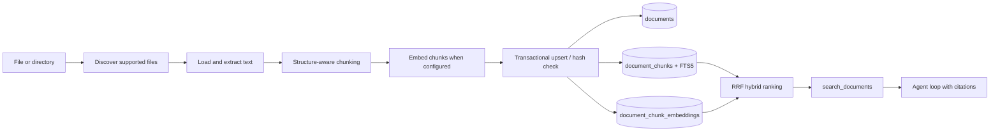

# Document Ingestion

The ingestion module turns operator-selected local files into cited chunks that
the agent can retrieve. Parsing and chunking are local; embedding calls the
configured provider when vector retrieval is enabled.



## Run it

```bash
python -m tini ingest ./internal-docs
python -m tini documents --search "deployment rollback"
```

## Use the dashboard

Run `uv run tini dashboard`, then open **Knowledge**. The page provides file and
folder pickers, drag-and-drop upload, a live stage lane, the indexed document
library, chunk inspection, and a retrieval probe. Uploads are written beneath
`.tini/documents/<workspace>/` before ingestion so reindexing has a stable source.
The light/dark switch in the header persists the selected theme in the browser.

Removing a library item removes its chunks and FTS rows, but deliberately keeps
the managed source file. Reindex reads that source again and atomically replaces
the document's chunks.

Directory ingestion is recursive by default. Use `--no-recursive` to index only
its direct children, or `--workspace engineering` to isolate a collection.
Supported formats are text, Markdown, HTML, CSV, JSON, YAML, PDF, and DOCX. The
PDF and DOCX parsers are included in the default installation.

## Guarantees

- Files larger than `TINI_DOCUMENT_MAX_FILE_BYTES` are rejected before parsing.
- Extracted text is capped by `TINI_DOCUMENT_MAX_TEXT_CHARS` before chunking.
- Directory traversal ignores symlinks and temporary Office files.
- HTML scripts and styles are excluded; parsers never execute document content.
- A content hash skips unchanged files. Changed files replace all old chunks in
  one SQLite transaction, including FTS5 rows and vectors.
- Retrieval applies `workspace_id` inside the database query and returns a
  title, source URI, and chunk ordinal for citation.

`EmbeddingProvider` isolates Gemini and OpenAI-compatible APIs from ingestion.
`DocumentIndex` is the storage seam. `SqliteDocumentIndex` stores float32 vectors
locally and scans them for cosine similarity; `QdrantDocumentIndex` is the
self-hosted vector upgrade path described below, and a future pgvector adapter
could keep the same interface while moving ANN search and RLS into Postgres.

## Self-hosted vector index (Qdrant)

```bash
docker compose up -d qdrant                 # http://localhost:6333/dashboard
pip install 'tini-agent[qdrant]'
```

```dotenv
TINI_DOCUMENT_INDEX=qdrant
TINI_QDRANT_URL=http://localhost:6333
# TINI_QDRANT_API_KEY=                      # only if you put Qdrant behind auth
# TINI_QDRANT_COLLECTION=tini_documents
TINI_EMBEDDING_PROVIDER=gemini              # required — see the trade-off below
TINI_EMBEDDING_MODEL=gemini-embedding-2
TINI_EMBEDDING_DIMENSIONS=768
```

`python -m tini ingest`, `tini documents`, the dashboard's Knowledge page, and
`search_documents` all pick up the backend from `TINI_DOCUMENT_INDEX` through
one shared factory (`tini.documents.store.make_document_index`) — nothing else
changes. `QdrantDocumentIndex` (`tini/documents/qdrant_store.py`) is semantic
search only: Qdrant has no BM25-equivalent ranked full-text search, so it skips
the RRF fusion `SqliteDocumentIndex` does with FTS5 and requires an embedder. A
chunk that would ingest without an embedding is refused rather than silently
dropped. The dashboard's per-chunk inspector (char offsets, embedded flag)
still reads SQLite's tables directly and returns an explicit "not available on
this backend" message under Qdrant — everything else (search, list, ingest,
delete, reindex) works the same on both backends.

## Chunking strategy

Chunks are not cut at a fixed character count. The chunker follows headings,
paragraphs, and sentences, then uses an estimated-token ceiling to stay within
embedding input limits. Overlap copies complete trailing semantic units and is
not carried across a new section. Configure the guardrails with:

```dotenv
TINI_DOCUMENT_CHUNK_MAX_TOKENS=512
TINI_DOCUMENT_CHUNK_MIN_TOKENS=120
TINI_DOCUMENT_CHUNK_OVERLAP_TOKENS=48
```

## Embedding configuration

Generation and embedding models are deliberately independent. Keep the chat
provider unchanged and configure Gemini embeddings with:

```dotenv
TINI_EMBEDDING_PROVIDER=gemini
TINI_EMBEDDING_MODEL=gemini-embedding-2
TINI_EMBEDDING_DIMENSIONS=768
# TINI_EMBEDDING_API_KEY=  # falls back to GEMINI_API_KEY
```

For an OpenAI-compatible embedding endpoint, set the provider to
`openai_compatible`, provide `TINI_EMBEDDING_BASE_URL`, and set its served model
ID. Changing the model or dimensions requires reindexing existing documents.
The query is embedded by the same provider/model as its stored chunks; results
are fused with FTS5 so exact identifiers and semantic matches both rank well.
