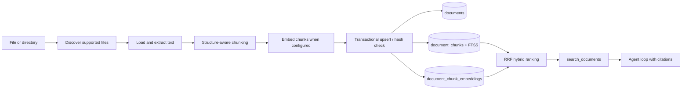

# Document Ingestion

The ingestion module turns operator-selected local files into cited chunks that
the agent can retrieve. Parsing and chunking are local; embedding calls the
configured provider when vector retrieval is enabled.



## Run it

```bash
python -m tini ingest ./internal-docs
python -m tini documents --search "deployment rollback"
```

## Use the dashboard

Run `uv run tini dashboard`, then open **Knowledge**. The page provides file and
folder pickers, drag-and-drop upload, a live stage lane, the indexed document
library, chunk inspection, and a retrieval probe. Uploads are written beneath
`.tini/documents/<workspace>/` before ingestion so reindexing has a stable source.
The light/dark switch in the header persists the selected theme in the browser.

Removing a library item removes its chunks and FTS rows, but deliberately keeps
the managed source file. Reindex reads that source again and atomically replaces
the document's chunks.

Directory ingestion is recursive by default. Use `--no-recursive` to index only
its direct children, or `--workspace engineering` to isolate a collection.
Supported formats are text, Markdown, HTML, CSV, JSON, YAML, PDF, and DOCX. The
PDF and DOCX parsers are included in the default installation.

## Guarantees

- Files larger than `TINI_DOCUMENT_MAX_FILE_BYTES` are rejected before parsing.
- Extracted text is capped by `TINI_DOCUMENT_MAX_TEXT_CHARS` before chunking.
- Directory traversal ignores symlinks and temporary Office files.
- HTML scripts and styles are excluded; parsers never execute document content.
- A content hash skips unchanged files. Changed files replace all old chunks in
  one SQLite transaction, including FTS5 rows and vectors.
- Retrieval applies `workspace_id` inside the database query and returns a
  title, source URI, and chunk ordinal for citation.
- A PDF encrypted with only an empty user password (common for official/
  government filings, e.g. Japan's EDINET securities reports — restricting
  printing/copying in a viewer, not reading) is decrypted automatically. One
  with a real password still fails with a clear `DocumentLoadError`.
- Chunk-size estimation counts CJK characters (Chinese/Japanese/Korean) each
  as their own token rather than collapsing an entire unbroken paragraph into
  one `\w+` match — otherwise `max_tokens` stopped meaning anything for
  scripts with no spaces between words.

`EmbeddingProvider` isolates Gemini and OpenAI-compatible APIs from ingestion.
`DocumentIndex` is the storage seam. `SqliteDocumentIndex` stores float32 vectors
locally and scans them for cosine similarity; `QdrantDocumentIndex` is the
self-hosted vector upgrade path described below, and a future pgvector adapter
could keep the same interface while moving ANN search and RLS into Postgres.

## Self-hosted vector index (Qdrant)

```bash
docker compose up -d qdrant                 # http://localhost:6333/dashboard
pip install 'tini-agent[qdrant]'
```

```dotenv
TINI_DOCUMENT_INDEX=qdrant
TINI_QDRANT_URL=http://localhost:6333
# TINI_QDRANT_API_KEY=                      # only if you put Qdrant behind auth
# TINI_QDRANT_COLLECTION=tini_documents
TINI_EMBEDDING_PROVIDER=gemini              # required — see the trade-off below
TINI_EMBEDDING_MODEL=gemini-embedding-2
TINI_EMBEDDING_DIMENSIONS=768
```

`python -m tini ingest`, `tini documents`, the dashboard's Knowledge page, and
`search_documents` all pick up the backend from `TINI_DOCUMENT_INDEX` through
one shared factory (`tini.documents.store.make_document_index`) — nothing else
changes. `QdrantDocumentIndex` (`tini/documents/qdrant_store.py`) is semantic
search only: Qdrant has no BM25-equivalent ranked full-text search, so it skips
the RRF fusion `SqliteDocumentIndex` does with FTS5 and requires an embedder. A
chunk that would ingest without an embedding is refused rather than silently
dropped. The dashboard's per-chunk inspector (char offsets, embedded flag)
still reads SQLite's tables directly and returns an explicit "not available on
this backend" message under Qdrant — everything else (search, list, ingest,
delete, reindex) works the same on both backends.

## Multilingual corpora: pick a multilingual embedding model

`nomic-embed-text` (the example above) is English-centric. Measured on the
DENSO corpus (English PDFs plus a 170-page Japanese securities report) with
the 31-question multilingual set in `evals/documents/denso_qa_multilingual.jsonl`
(Japanese, Vietnamese and English questions, several asked in a different
language than the document), same chunks, same Qdrant, only the embedding
model changed:

| | nomic-embed-text (768d) | bge-m3 (1024d) |
|---|---|---|
| Multilingual recall@3 | 17/31 (55%) | 30/31 (97%) |
| Japanese question | 12/15 | 15/15 |
| Vietnamese question | 5/12 | 11/12 |
| English question, Japanese document | 0/4 | 4/4 |
| Expected keywords found (Japanese) | 6/25 | 21/25 |
| English set recall@3 | 36/38 | 36/38 |
| Median query latency | 86 ms | 75 ms |

```bash
docker compose exec ollama ollama pull bge-m3
```

```dotenv
TINI_EMBEDDING_MODEL=bge-m3
TINI_EMBEDDING_DIMENSIONS=1024
TINI_QDRANT_COLLECTION=tini_documents_bge3   # vectors are a different size: use a new collection
```

Ingest cost was not compared like for like: bge-m3 took 11 min for the whole
corpus on CPU (including one OCR'd PDF); nomic took 5.5 min for the 395-chunk
Japanese report alone. A different model or dimension needs a fresh collection and a full re-ingest
(the same source hash is otherwise skipped). Keeping the old collection lets
you compare both models on the same questions from the dashboard's Retrieval
eval. Numbers are one run on CPU; embeddings are not perfectly deterministic,
so expect a question or two of run-to-run variation.

## OCR fallback for scanned/image-only pages

A PDF page averaging under ~40 extracted characters is treated as scanned:
`pypdf`'s plain text extraction found essentially nothing, most likely because
the page is a raster image rather than real text. Left unconfigured, that
page ingests as-is — usually near-empty — with an `ocr_skipped` note in the
document's metadata so it's visible *why*, rather than a thin document just
quietly looking like a thin source.

```bash
pip install 'tini-agent[ocr]'
```

```dotenv
TINI_OCR_PROVIDER=deepseek
TINI_OCR_MODEL=deepseek-v4-flash-vision-exp
# TINI_OCR_API_KEY=   # falls back to DEEPSEEK_API_KEY / OPENAI_API_KEY
# TINI_OCR_BASE_URL=  # falls back to the provider's known default endpoint
```

`tini/documents/ocr.py` tried CPU-only local OCR (PaddleOCR) first, since a
self-hosted default matches this project's local-first defaults — abandoned
after three attempts, all failing the same way (an unimplemented oneDNN
CPU-backend op) or hanging indefinitely with oneDNN disabled. `TINI_OCR_*`
instead points at a vision-capable chat model over the same OpenAI-compatible
wire format the embedding providers already use; any such endpoint works, not
just DeepSeek. When a page looks scanned, `tini/documents/loaders.py` renders
it to a bitmap with `pypdfium2` (PDFium — the engine Chrome uses; no external
poppler binary) exactly as a viewer would show it, and sends that image to
the model with a transcription prompt. Pulling the page's embedded image out
directly via `pypdf` was tried first and abandoned too: on real scanned PDFs
it frequently decoded the wrong or a corrupted fragment (mismatched
image/soft-mask dimensions), silently losing most of the page's content — a
composed-page render doesn't have that failure mode. One page's OCR call
failing doesn't sink the whole document; the failure count lands in
`ocr_failed_pages` instead of vanishing.

## Chunking strategy

Chunks are not cut at a fixed character count. The chunker follows headings,
paragraphs, and sentences, then uses an estimated-token ceiling to stay within
embedding input limits. Overlap copies complete trailing semantic units and is
not carried across a new section. Configure the guardrails with:

```dotenv
TINI_DOCUMENT_CHUNK_MAX_TOKENS=512
TINI_DOCUMENT_CHUNK_MIN_TOKENS=120
TINI_DOCUMENT_CHUNK_OVERLAP_TOKENS=48
```

## Embedding configuration

Generation and embedding models are deliberately independent. Keep the chat
provider unchanged and configure Gemini embeddings with:

```dotenv
TINI_EMBEDDING_PROVIDER=gemini
TINI_EMBEDDING_MODEL=gemini-embedding-2
TINI_EMBEDDING_DIMENSIONS=768
# TINI_EMBEDDING_API_KEY=  # falls back to GEMINI_API_KEY
```

For an OpenAI-compatible embedding endpoint, set the provider to
`openai_compatible`, provide `TINI_EMBEDDING_BASE_URL`, and set its served model
ID. Changing the model or dimensions requires reindexing existing documents.
The query is embedded by the same provider/model as its stored chunks; results
are fused with FTS5 so exact identifiers and semantic matches both rank well.
