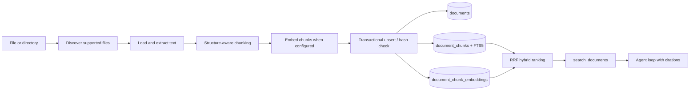

# Document Ingestion

The ingestion module turns operator-selected local files into cited chunks that
the agent can retrieve. Parsing and chunking are local; embedding calls the
configured provider when vector retrieval is enabled.



## Run it

```bash
python -m tini ingest ./internal-docs
python -m tini documents --search "deployment rollback"
```

## Use the dashboard

Run `uv run tini dashboard`, then open **Knowledge**. The page provides file and
folder pickers, drag-and-drop upload, a live stage lane, the indexed document
library, chunk inspection, and a retrieval probe. Uploads are written beneath
`.tini/documents/<workspace>/` before ingestion so reindexing has a stable source.
The light/dark switch in the header persists the selected theme in the browser.

Removing a library item removes its chunks and FTS rows, but deliberately keeps
the managed source file. Reindex reads that source again and atomically replaces
the document's chunks.

Directory ingestion is recursive by default. Use `--no-recursive` to index only
its direct children, or `--workspace engineering` to isolate a collection.
Supported formats are text, Markdown, HTML, CSV, JSON, YAML, PDF, and DOCX. The
PDF and DOCX parsers are included in the default installation.

## Guarantees

- Files larger than `TINI_DOCUMENT_MAX_FILE_BYTES` are rejected before parsing.
- Extracted text is capped by `TINI_DOCUMENT_MAX_TEXT_CHARS` before chunking.
- Directory traversal ignores symlinks and temporary Office files.
- HTML scripts and styles are excluded; parsers never execute document content.
- A content hash skips unchanged files. Changed files replace all old chunks in
  one SQLite transaction, including FTS5 rows and vectors.
- Retrieval applies `workspace_id` inside the database query and returns a
  title, source URI, and chunk ordinal for citation.
- A PDF encrypted with only an empty user password (common for official/
  government filings, e.g. Japan's EDINET securities reports — restricting
  printing/copying in a viewer, not reading) is decrypted automatically. One
  with a real password still fails with a clear `DocumentLoadError`.
- Chunk-size estimation counts CJK characters (Chinese/Japanese/Korean) each
  as their own token rather than collapsing an entire unbroken paragraph into
  one `\w+` match — otherwise `max_tokens` stopped meaning anything for
  scripts with no spaces between words.

`EmbeddingProvider` isolates Gemini and OpenAI-compatible APIs from ingestion.
`DocumentIndex` is the storage seam. `SqliteDocumentIndex` stores float32 vectors
locally and scans them for cosine similarity; `QdrantDocumentIndex` is the
self-hosted vector upgrade path described below, and a future pgvector adapter
could keep the same interface while moving ANN search and RLS into Postgres.

## Self-hosted vector index (Qdrant)

```bash
docker compose up -d qdrant                 # http://localhost:6333/dashboard
pip install 'tini-agent[qdrant]'
```

```dotenv
TINI_DOCUMENT_INDEX=qdrant
TINI_QDRANT_URL=http://localhost:6333
# TINI_QDRANT_API_KEY=                      # only if you put Qdrant behind auth
# TINI_QDRANT_COLLECTION=tini_documents
TINI_EMBEDDING_PROVIDER=gemini              # required — see the trade-off below
TINI_EMBEDDING_MODEL=gemini-embedding-2
TINI_EMBEDDING_DIMENSIONS=768
```

`python -m tini ingest`, `tini documents`, the dashboard's Knowledge page, and
`search_documents` all pick up the backend from `TINI_DOCUMENT_INDEX` through
one shared factory (`tini.documents.store.make_document_index`) — nothing else
changes. `QdrantDocumentIndex` (`tini/documents/qdrant_store.py`) is semantic
search only: Qdrant has no BM25-equivalent ranked full-text search, so it skips
the RRF fusion `SqliteDocumentIndex` does with FTS5 and requires an embedder. A
chunk that would ingest without an embedding is refused rather than silently
dropped. The dashboard's per-chunk inspector (char offsets, embedded flag)
still reads SQLite's tables directly and returns an explicit "not available on
this backend" message under Qdrant — everything else (search, list, ingest,
delete, reindex) works the same on both backends.

## Where the original files live (MinIO)

The index holds chunks only; the uploaded ORIGINAL used to be a file under
`TINI_HOME/documents/<workspace>/`, recorded as a `file://` source_uri — gone
with the container's volume and invisible to other machines. With
`TINI_DOCUMENT_STORAGE=minio` (`tini/documents/blobstore.py`) the dashboard
upload stores the original in an S3-compatible bucket instead, and the
document's `source_uri` becomes `s3://<bucket>/<workspace>/<name>`. That URI
scheme is the "where is the original" flag: the dashboard shows **MinIO** vs
**local file** per document, and Re-index fetches from the bucket and updates
the same document (no `file://` twin).

```bash
# .env: TINI_DOCUMENT_STORAGE=minio, TINI_MINIO_ACCESS_KEY, TINI_MINIO_SECRET_KEY
docker compose --profile minio up -d      # console: http://localhost:9001
```

No default credentials: choose them in `.env` (the compose profile passes the
same two values to MinIO as its root user). The bucket is created on first
upload; `pip install 'tini-agent[minio]'` for bare metal (the image has it).

- Reads are limited to the configured bucket — a `source_uri` naming another
  bucket or an unsafe key is refused, since that field comes back out of the
  index.
- **Remove** deletes the index entry only; the original stays in the bucket.
- Only dashboard uploads use this. `tini ingest <path>` still indexes local
  files with `file://` URIs.
- Documents already ingested keep their `file://` URI; re-upload to move one.

## Multilingual corpora: pick a multilingual embedding model

`nomic-embed-text` (the example above) is English-centric. Measured on the
DENSO corpus (English PDFs plus a 170-page Japanese securities report) with
the 31-question multilingual set in `evals/documents/denso_qa_multilingual.jsonl`
(Japanese, Vietnamese and English questions, several asked in a different
language than the document), same chunks, same Qdrant, only the embedding
model changed:

| | nomic-embed-text (768d) | bge-m3 (1024d) |
|---|---|---|
| Multilingual recall@3 | 17/31 (55%) | 30/31 (97%) |
| Japanese question | 12/15 | 15/15 |
| Vietnamese question | 5/12 | 11/12 |
| English question, Japanese document | 0/4 | 4/4 |
| Expected keywords found (Japanese) | 6/25 | 21/25 |
| English set recall@3 | 36/38 | 36/38 |
| Median query latency | 86 ms | 75 ms |

```bash
docker compose exec ollama ollama pull bge-m3
```

```dotenv
TINI_EMBEDDING_MODEL=bge-m3
TINI_EMBEDDING_DIMENSIONS=1024
TINI_QDRANT_COLLECTION=tini_documents_bge3   # vectors are a different size: use a new collection
```

Ingest cost was not compared like for like: bge-m3 took 11 min for the whole
corpus on CPU (including one OCR'd PDF); nomic took 5.5 min for the 395-chunk
Japanese report alone. A different model or dimension needs a fresh collection and a full re-ingest
(the same source hash is otherwise skipped). Keeping the old collection lets
you compare both models on the same questions from the dashboard's Retrieval
eval. Numbers are one run on CPU; embeddings are not perfectly deterministic,
so expect a question or two of run-to-run variation.

**GPU**: embedding is CPU-compute-bound, not request-bound — client-side
batching/concurrency has little effect, but an NVIDIA GPU does. Uncomment the
`deploy.resources.reservations` block under the `ollama` service in
`docker-compose.yml` (needs the [NVIDIA Container
Toolkit](https://docs.nvidia.com/datacenter/cloud-native/container-toolkit/latest/install-guide.html)
on the host; verify with `docker run --rm --gpus all nvidia/cuda:12.4.0-base-ubuntu22.04 nvidia-smi`
before assuming it's wired up). Measured on an RTX 3050 laptop GPU (6 GB VRAM,
comfortably fits bge-m3's ~1.2 GB): steady-state bge-m3 throughput went from
~1.3 s/chunk on CPU to ~55-60 ms/chunk on GPU, about 22x on raw embedding
calls; a full re-ingest of this corpus dropped from 11 min to well under a
minute end to end (chunking/indexing overhead included, so the wall-clock
speedup is somewhat less than the raw per-chunk number).

## Reranking (optional, hosted provider only so far)

Vector search returns the chunks nearest the question. In the
[baseline](eval-baseline.md) the right document is found ~95% of the time but
for table-heavy sources only 62% of the expected facts appear in the returned
chunks: the answer chunk is near, not nearest. Reranking fetches a wider pool
(`TINI_RERANK_CANDIDATES`, default 20), lets a second model score each
candidate against the question, and keeps the best `top_k`. It wraps any
index (`RerankingIndex`), so the agent's `search_documents` tool, the CLI and
the dashboard all get it.

```dotenv
TINI_RERANK_PROVIDER=jev
TYPESAFE_API_KEY=...
```

**Status: measured against the live API, once (2026-09-24), on the 47-question
multilingual set at k=3.** Recall went from 40/47 (85%) to 43/47 (92%) — a
real gain, but concentrated and uneven, and it comes at a steep latency cost:

| | off | on (Jev) |
|---|---|---|
| recall@3 | 40/47 (85%) | 43/47 (92%) |
| ja | 25/28 (89%) | 27/28 (96%) |
| vi | 10/13 (77%) | 10/13 (77%) — **no change** |
| en | 5/6 (83%) | 6/6 (100%) |
| table-heavy-pdf | 23/27 (85%) | 24/27 (89%) |
| text-pdf | 15/18 (83%) | 17/18 (94%) |
| scanned-pdf | 2/2 (100%) | 2/2 (100%) — n too small to move |
| median latency | 20.5 ms | 1378.4 ms |
| p95 latency | 98.7 ms | 1652.2 ms |

Vietnamese got zero benefit — the exact risk the "language support
undocumented" caveat below was flagging, now confirmed rather than
hypothetical. Median latency went from 20.5 ms to 1378.4 ms, ~67x — one
search now costs over a second, well above TypeSafe's own 70-500 ms claim
(see the Latency bullet below); if a brief asks for "retrieval latency" as
the headline number, this is not a free accuracy win. One run, one corpus —
re-run `python scripts/document_baseline.py with-jev --rerank on --compare
evals/baselines/bge-m3-dense-2026-09-24.json` before trusting this further
or deciding whether the tradeoff is worth it for a given use case.

**With an LLM on top (DeepSeek, same run + reranking on):** recall/by-lang/
by-format matched the retrieval-only Jev run above (43/47, ja 27/28, vi
10/13, en 6/6) — reassuring, not a fluke of that one run — with median
retrieval latency 1520.5 ms (p95 1958.2 ms, in the same range as before).
The new number is **answer keyword rate: 77%** — of the expected keywords,
how many actually appear in DeepSeek's generated answer text (not just the
retrieved chunks) — plus a median **~5496 ms** per LLM call on top of
retrieval. End to end, one question costs roughly 1.5 s retrieval+rerank +
5.5 s generation ≈ 7 s. No LLM-mode run without reranking exists yet to
isolate how much of that 77% the reranking step itself is responsible for
versus DeepSeek's own answer quality.

- **Jev is not a purpose-built reranker.** It is TypeSafe's hosted "System
  One" decision model (typed answers with calibrated probabilities). Here it
  is asked one yes/no question per candidate ("does this document contain what
  the query asks for?") and the returned probability is the score. Its docs
  do not state language support, so Japanese and Vietnamese quality is an
  open question the eval has to answer.
- **Privacy.** Every search sends the question and the candidate chunks' text
  to `api.typesafe.ai`. The endpoint is fixed in the code on purpose — a
  setting that could redirect document text elsewhere is a way to leak it.
  Provider `none` keeps everything local.
- **Failure is visible, not silent.** If the provider errors, the search falls
  back to vector order and the failure is counted; the eval reports
  "N of M searches fell back", so an outage cannot pass as "reranking made no
  difference".
- **Latency.** One extra network call per search. TypeSafe reports 70-500 ms;
  measured from this network median latency was 1378 ms (p95 1652 ms) —
  well above that claim, whether from geography (the service is hosted in
  US West), the 20-candidate batch per call, or something else unmeasured.
- **Self-hosted alternative (researched, not built).** `bge-reranker-v2-m3`
  (Apache-2.0, same family as bge-m3) behind Hugging Face text-embeddings-
  inference's CPU image exposes `POST /rerank`. Ollama has no rerank endpoint.
  No CPU latency was verified for it.

## OCR fallback for scanned/image-only pages

A PDF page averaging under ~40 extracted characters is treated as scanned:
`pypdf`'s plain text extraction found essentially nothing, most likely because
the page is a raster image rather than real text. Left unconfigured, that
page ingests as-is — usually near-empty — with an `ocr_skipped` note in the
document's metadata so it's visible *why*, rather than a thin document just
quietly looking like a thin source.

```bash
pip install 'tini-agent[ocr]'
```

```dotenv
TINI_OCR_PROVIDER=deepseek
TINI_OCR_MODEL=deepseek-v4-flash-vision-exp
# TINI_OCR_API_KEY=   # falls back to DEEPSEEK_API_KEY / OPENAI_API_KEY
# TINI_OCR_BASE_URL=  # falls back to the provider's known default endpoint
```

`tini/documents/ocr.py` tried CPU-only local OCR (PaddleOCR) first, since a
self-hosted default matches this project's local-first defaults — abandoned
after three attempts, all failing the same way (an unimplemented oneDNN
CPU-backend op) or hanging indefinitely with oneDNN disabled. `TINI_OCR_*`
instead points at a vision-capable chat model over the same OpenAI-compatible
wire format the embedding providers already use; any such endpoint works, not
just DeepSeek. When a page looks scanned, `tini/documents/loaders.py` renders
it to a bitmap with `pypdfium2` (PDFium — the engine Chrome uses; no external
poppler binary) exactly as a viewer would show it, and sends that image to
the model with a transcription prompt. Pulling the page's embedded image out
directly via `pypdf` was tried first and abandoned too: on real scanned PDFs
it frequently decoded the wrong or a corrupted fragment (mismatched
image/soft-mask dimensions), silently losing most of the page's content — a
composed-page render doesn't have that failure mode. One page's OCR call
failing doesn't sink the whole document; the failure count lands in
`ocr_failed_pages` instead of vanishing.

### What OCR costs per document

Every OCR'd document appends one row to `TINI_HOME/ocr_usage.jsonl` — title,
pages, prompt and completion tokens, provider/model, and whether the run was
kept (`created`/`updated`) or discarded (`skipped`). Tokens only: dollars are
derived when read (`tini/ops/ocr_cost.py`), so correcting a rate fixes past
rows. The dashboard's Documents header shows the average per document once
any scanned file has been ingested (hover for per-page cost and the rate).

Measured 2026-09-25 with `deepseek-v4-flash-vision-exp` on the one scanned
file in the corpus (`supply-chain-doc-sustainability-guidelines-en.pdf`,
15 pages, rendered at 2x):

| | per page | per 15-page document |
|---|---|---|
| prompt tokens | 1,080 (identical every run: a page image is a fixed size) | 16,200 |
| completion tokens | ~400-430 (the transcription; varied 5,979 vs 6,431 between runs) | ~6,000-6,400 |
| cost at $0.15 / $0.30 per M tokens | ~$0.00029 | ~$0.0043 |
| cost at the provider-level $0.435 / $0.87 estimate | ~$0.00084 | ~$0.0126 |

The two rate rows are the same tokens priced two ways: the model is documented
as priced like `deepseek-v4-flash` ($0.15/$0.30) but `tini/ops/pricing.py`'s
generic `deepseek` fallback is ~2.9x higher, so treat the dollar figure as an
estimate and check your provider's current price. Average cost per document
scales with page count: **cost ≈ pages x ~$0.0003** at the lower rate. One
sample document, so the per-document average is really a per-page average
times your page count. Wall-clock for the 15 pages with 4-way concurrency was
~15 s.

**Each page is OCR'd once.** OCR runs before the index decides whether a file
is unchanged, so a plain re-ingest used to pay for the whole document again and
then report `skipped` (measured: the same ~$0.0042 and ~14 s for nothing). It
would also have re-paid whenever the text had to be re-read for a new embedding
model or chunk size. Instead the transcription of each page is cached under
`TINI_HOME/ocr_cache/`, keyed by the page image, the OCR model and the prompt
version (`PROMPT_VERSION` in `tini/documents/ocr.py` — bump it if you change the
prompt). Only successful responses are cached (a failed page is retried next
time; a blank page is a real result and is cached). Re-checked with the real
API on the same 15-page file: run 1 paid (15 pages, ~$0.005), runs 2 and 3
made no API call (30 cached pages, `wasted_cost` 0, ~5 s instead of ~14 s).
The ledger's `cached_pages` counts the pages served this way. The cache holds
document text in plain files under `TINI_HOME`, like the index does; deleting
a document does not delete its cached pages, and `rm -r ocr_cache` is safe
(the only cost is paying again).

## What re-ingesting costs after a manual edit

Ingestion embeds a document's chunks *before* the index decides whether the
file changed, so re-ingesting used to re-embed everything: measured on the
338-chunk Japanese Integrated Report (local GPU), an **unchanged** re-ingest
embedded all 338 chunks (23 s) and then reported `skipped`, and a
**one-paragraph edit** embedded all 338 again (23 s). With a hosted embedding
API that is money, not just time. Vectors are now cached in
`TINI_HOME/embed_cache.sqlite` by a hash of (provider, model, dimensions,
title, chunk text) — `TINI_EMBEDDING_CACHE=0` turns it off:

| re-ingest of the same report | chunks embedded | time |
|---|---|---|
| first ingest | 338 | ~40 s |
| unchanged file | 0 | 0.2 s |
| one paragraph edited by hand | 1 | 1.0 s |

Chunks are cut on paragraph/heading boundaries, so an edit only changes the
chunk(s) around it. OCR has its own per-page cache (see the OCR section), so a
scanned file costs API money only for pages whose image changed. A different
embedding model, a renamed document (the title is part of the key) or a new
chunk size still re-embeds — those really are different vectors. Queries are
never cached. The cache stores vectors, not chunk text; deleting a document
does not delete its cached vectors, and removing the file is always safe.

## Managing documents: the catalog

The dashboard's Knowledge page keeps a **catalog** next to the index: for each
document a type (report, governance, internal policy, supplier requirements,
other), a kind, a period/version (e.g. `FY2024`), an issuer, a status (current,
superseded, needs checking, excluded), an optional summary, and a profile of how
it is built (pages, language, scanned or text, table density). It lives in
`TINI_HOME/state.db` (`tini/documents/catalog.py`), keyed by (workspace,
source URI), so it works the same under SQLite and Qdrant. The library can be
filtered by type or by "needs review", and **Edit** opens the entry.

**Classification** is rule-based (title, filename, the first ~3,000 characters),
reports a confidence and the text that triggered it, and flags anything under
80% for review instead of trusting it. A document names itself at the top
("統合報告書2025", "Corporate Governance Report") and only *mentions* other
types later, so the earliest match wins, not the most confident one (picking by
confidence labelled the Integrated Report a securities filing). On the 9 DENSO
files it matches my hand labels 9/9, but the rules were tuned on those same
files, so this is a sanity check, not an independent accuracy figure. The
"table-heavy" threshold (0.10) rests on one example. No model is called.

**Refresh catalog** classifies every indexed document from the text the index
already holds (`opening_text`): no original is re-read, nothing is OCR'd or
embedded, so it costs nothing (9 documents: 2 s) and works for documents whose
original this machine cannot open. That matters here: 8 of the 9 DENSO
documents were ingested from a Windows host path (`file:///D:/...`) that the
container cannot read, so **Re-index fails for them** while cataloguing works.

**What editing and re-ingesting cost:**

| action | API/model cost | time |
|---|---|---|
| edit type / period / status / summary | none — metadata only, no re-ingest | instant |
| refresh catalog (9 documents) | none | ~2 s |
| re-index an unchanged file | none: OCR pages and chunk vectors come from their caches | dominated by PDF parsing, ~17.5 s for a 56-page Japanese PDF (pypdf, CPU) |
| one paragraph of a document edited | 1 of 338 chunks embedded | ~1 s for text files; PDFs add the parse time |
| scanned file, unchanged | 0 OCR pages (cached) | render only |

An edited field is **locked**: a later re-ingest of a changed file refreshes the
profile and the automatic fields but never overwrites a locked one, and if an
automatic field would have changed it flags the entry for review. Unchanged
content (same hash) is not re-classified at all. Removing a document removes its
catalog entry. Re-parsing the same unchanged PDF is the one remaining repeated
cost, and it is time, not money.

## Chunking strategy

Chunks are not cut at a fixed character count. The chunker follows headings,
paragraphs, and sentences, then uses an estimated-token ceiling to stay within
embedding input limits. Overlap copies complete trailing semantic units and is
not carried across a new section. Configure the guardrails with:

```dotenv
TINI_DOCUMENT_CHUNK_MAX_TOKENS=512
TINI_DOCUMENT_CHUNK_MIN_TOKENS=120
TINI_DOCUMENT_CHUNK_OVERLAP_TOKENS=48
```

## Embedding configuration

Generation and embedding models are deliberately independent. Keep the chat
provider unchanged and configure Gemini embeddings with:

```dotenv
TINI_EMBEDDING_PROVIDER=gemini
TINI_EMBEDDING_MODEL=gemini-embedding-2
TINI_EMBEDDING_DIMENSIONS=768
# TINI_EMBEDDING_API_KEY=  # falls back to GEMINI_API_KEY
```

For an OpenAI-compatible embedding endpoint, set the provider to
`openai_compatible`, provide `TINI_EMBEDDING_BASE_URL`, and set its served model
ID. Changing the model or dimensions requires reindexing existing documents.
The query is embedded by the same provider/model as its stored chunks; results
are fused with FTS5 so exact identifiers and semantic matches both rank well.
